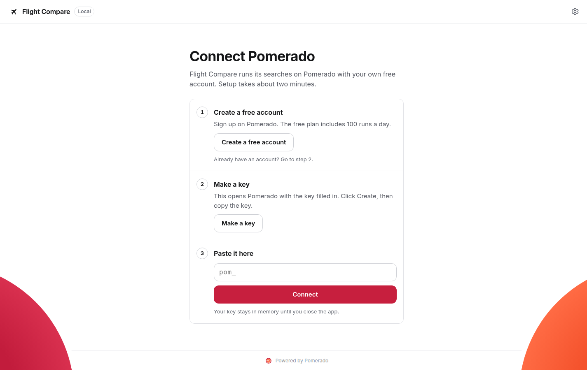

# pomerado-app-kit

The shared pieces for small, free Electron apps that run [Pomerado](https://pomerado.ai) tools with
the person's own key. Each app supplies a recipe (what it asks, which tools it runs, how results line
up) and the kit does the rest.



## What's in it

| Part | What it does |
|---|---|
| `connect` | Onboarding on rails: create a free account, make a key with the Dashboard's prefilled form, paste it, check it with `GET /v1/quota`, show runs left |
| bridge | Main process holds the key in the OS keychain (`safeStorage`) and makes every API call. The window talks to it over a fixed IPC surface and sees job handles, never the key or job ids |
| `engine` | Fan-out with a concurrency limit, a status line per site, results as each site finishes, per-site timeouts, cancel on leave, cursor paging |
| `errors` | Every Pomerado error code as a plain title, a next step and one action |
| `forms` | Form fields from an `input_schema`, with validation |
| `results` | Best pick banner, comparison table, cards, source links, empty state |
| `needs_input` | A run waiting on the person opens Pomerado's answer page in the system browser and keeps polling |
| quota | Out of runs for the day: when they come back, and an Upgrade to Premium link |
| `ui` | White ground, Pomerado crimson for the one primary action, Inter, 12 px corners, 390 px first |

Every word the kit shows is in [`src/shared/copy.ts`](src/shared/copy.ts).

## Entry points

The kit never imports Electron. Each process passes in what it uses.

```ts
// main process
import { app, ipcMain, net, safeStorage, shell } from "electron";
import { createPomeradoMain } from "pomerado-app-kit/main";

const pomerado = createPomeradoMain({
  appName: "My App",
  userDataPath: app.getPath("userData"),
  ipcMain,
  safeStorage,
  openExternal: (url) => shell.openExternal(url),
  fetch: (url, init) => net.fetch(url, init),
});
app.on("before-quit", () => void pomerado.cancelAll());
```

```ts
// preload (bundle it: sandboxed preloads can't load packages)
import { contextBridge, ipcRenderer } from "electron";
import { exposePomerado } from "pomerado-app-kit/preload";

exposePomerado(contextBridge, ipcRenderer);
```

```tsx
// renderer
import "pomerado-app-kit/styles.css";
import { ConnectScreen, PomeradoProvider, SiteStatusList, useFanOut } from "pomerado-app-kit/renderer";

function Search() {
  const fanOut = useFanOut();
  // fanOut.start([{ key, label, toolId, input, timeoutMs }, ...])
  return fanOut.state ? <SiteStatusList sites={fanOut.state.sites} onAnswer={fanOut.answer} onRetry={fanOut.retry} /> : null;
}
```

`pomerado-app-kit/shared` holds the pure parts (engine, errors, forms, copy, formatting, types),
usable anywhere.

Load Inter yourself, for example with `@fontsource-variable/inter`.

## How the bridge stays safe

- The key is encrypted with the OS keychain and never written in plain text. Where the system has no
  real keychain (Linux without a secret service), it stays in memory until the app closes.
- Runs go to `POST /v1/runs/read-only` only, each with its own idempotency key. Apps with a write
  step will add a confirm sheet first.
- Tool ids must look like `tool_` and 32 hex digits. Job handles are random and map to job ids in
  main only.
- Only `https` addresses open in the system browser.
- Changing the API address in Settings deletes the key, so a key only goes to the API it was
  checked against.
- When a window reloads, navigates or closes, or the app quits, main cancels that window's running
  jobs, except a job Pomerado is repairing, which is left to finish as the docs ask.

## Build

```sh
npm install
npm run build      # dist/
npm run typecheck
```

The kit is tested end to end through the apps that use it, starting with
[Flight Compare](https://github.com/Pomerado/flight-compare).

## License

MIT
